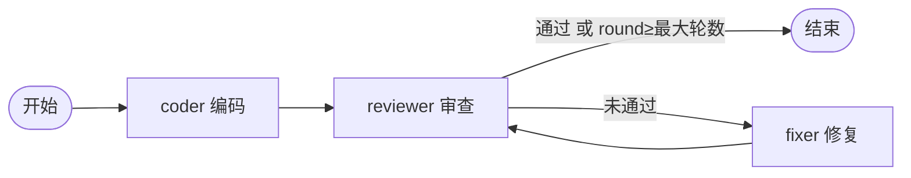

# 设计说明

## 1. 做了什么

选的方向是"代码审查流程"。输入一句编程需求，输出一份经过审查和修改的 Python 代码。三个 Agent 的分工：

| Agent | 做什么 | 读状态 | 写状态 |
|-------|--------|--------|--------|
| coder | 根据需求写出第一版代码 | task | code, round |
| reviewer | 审查代码，给出是否通过和问题列表 | task, code | review |
| fixer | 按审查意见修改代码 | task, code, review | code, round |

## 2. 流程图



没有 mermaid 渲染的话，看这个文字版：

```
coder -> reviewer --通过--------------------> 结束
             |  ^
             |  +------ fixer <--+
             +--未通过-----------+
```

## 3. 状态管理

Agent 之间不互相调用，也不直接传参数，统一读写一个 `State` 对象（`state.py`）。它里面是一个字典 `data` 存业务数据，再加一个列表 `trace` 存执行记录。

这样做的原因是想让 Agent 之间松耦合：reviewer 只关心 state 里有没有 `code`，不关心代码是 coder 写的还是 fixer 改的。后面加新 Agent 的时候，只要约定好自己读哪些 key、写哪些 key，旧的不用动。

本流程里用到的 key：

- `task`：用户的需求
- `code`：当前版本的代码
- `review`：`{"passed": 是否通过, "issues": [问题列表]}`
- `round`：已经修复了几轮
- `failed_at` / `stopped`：流程异常结束时才有，分别表示哪个节点失败、是不是因为超过最大步数

## 4. 流程控制

流程引擎在 `workflow.py` 里，大概一百行。规则只有三条：

1. 每个 Agent 是一个节点，第一个加进去的是起点。
2. 边用 `add_edge(src, dst, cond)` 添加，`cond` 是一个接收 state 的函数，不写就表示无条件。
3. 节点跑完后按添加顺序检查它的出边，第一条条件成立的就是下一步，都不成立就结束。

所以条件分支和循环都是用边表示的。本流程里 reviewer 有两条出边：

```python
wf.add_edge("reviewer", END, lambda s: s.get("review")["passed"] or s.get("round") >= max_rounds)
wf.add_edge("reviewer", "fixer")
```

前一条命中就结束，否则走第二条去修复，fixer 再连回 reviewer，就形成了循环。`max_rounds` 保证了循环不会一直转下去。另外引擎本身还有一个 `max_steps` 兜底，防止以后有人配出死循环。

## 5. 错误处理

- 重试：某个 Agent 抛异常（网络超时、模型返回的 JSON 解析失败等），引擎会等一会儿再重试，默认最多再试 2 次。每次尝试都会记在 `trace` 里。
- 重试用完还是失败：流程停止，在 state 里记下 `failed_at`，主程序会提示是哪个节点出的问题，日志也会保存。
- 超过 `max_steps`：强制结束，记下 `stopped`。
- 启动前会检查所有边指向的节点是否存在，写错名字会直接报错，而不是跑到一半才发现。

## 6. 日志

运行时每一步都会打印一行（第几步、哪个 Agent、耗时）。结束后把完整的 `trace` 和最终状态存成 `logs/run_时间.json`，出问题时可以回头看是哪一步、第几次尝试出的错。

## 7. 怎么扩展

比如想在审查通过之后，再加一个"写文档"的 Agent：

1. 在 `agents.py` 里写一个 `DocAgent`，继承 `Agent`，设置 `name = "doc"`，在 `run` 里读 `state.get("code")`，把结果写到 `state.set("doc", ...)`。
2. 在 `main.py` 的 `build_workflow` 里加两行：

   ```python
   wf.add_agent(DocAgent(llm))
   wf.add_edge("reviewer", "doc", lambda s: s.get("review")["passed"])  # 放在去END的那条前面
   ```

   然后把 `doc` 连到 `END` 就行。

已有的三个 Agent 和流程引擎都不用改。同样地，想改流程（比如审查不过先让 coder 重写而不是 fixer 修）也只需要改 `build_workflow` 里的边。

## 8. 不足和以后想做的

- reviewer 目前只做了语法检查加模型判断，以后可以让它真的执行代码、跑生成的测试用例，这样判断会靠谱很多。
- 引擎现在是串行的，并行的话需要把"下一步"从单个节点改成一组节点，状态的写入也要考虑冲突，这次时间不够没做。
- 没有可视化编排界面，流程是写在代码里的。
